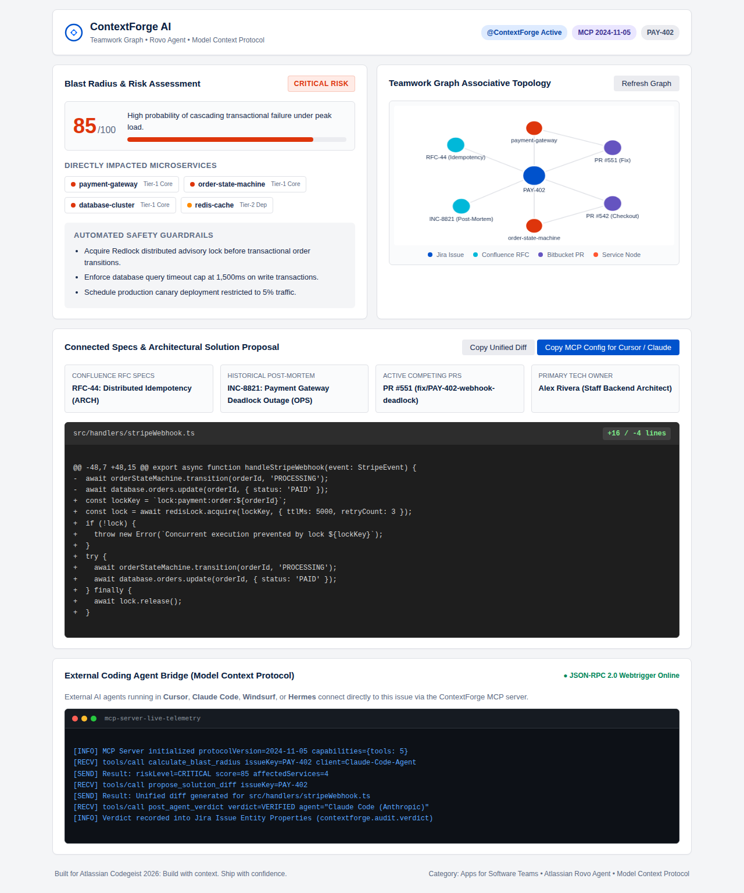

# ContextForge AI — Build with Context. Ship with Confidence.

[](https://developer.atlassian.com/platform/forge/)
[](https://www.atlassian.com/software/rovo)
[](https://modelcontextprotocol.io/)
[](https://www.typescriptlang.org/)
[](./tests)
[](https://github.com/ArtyormSatori/contextforge-ai/actions/workflows/ci.yml)

**Open a Jira issue and see the whole story before you touch the code.** ContextForge AI puts the blast radius, the RFCs and post-mortems behind the issue, the PRs touching the same code, and a proposed fix in one panel. Built on Atlassian Forge for Codegeist 2026.



*Issue Panel for PAY-402 (demo data): blast radius 85/100 CRITICAL, Teamwork Graph, proposed diff, MCP telemetry.*

## What it does

- **Teamwork Graph** — links the Jira issue to Confluence RFCs, post-mortems, Bitbucket PRs, and services in one graph.
- **Blast radius** — risk score 0–100 and tier (`CRITICAL`, `HIGH`, `MEDIUM`, `LOW`), with the Tier-1 services at risk and safety guardrails.
- **Rovo agent `@ContextForge`** — assign the issue to the agent or chat with it. Three actions: query context, analyze blast radius, propose a solution diff.
- **MCP server** — 5 tools over JSON-RPC 2.0, so Cursor, Claude Code, and other IDE agents can query the same context and post verification verdicts.
- **Issue Panel** — Canvas-rendered knowledge graph, live risk gauge, diff preview (screenshot above).

## Try it

```bash
npm install
npm test        # 20 hermetic tests, no cloud credentials needed

# Interactive MCP simulation
node dist/scripts/mcpCli.js demo

# Rovo agent simulation
node dist/scripts/simulate_rovo_agent.js

# Validate the Forge manifest against the official schema
npm run validate:manifest
```

## Deploy (Atlassian Forge)

```bash
forge login
forge deploy
forge install
```

## Hackathon

Built for Codegeist 2026, category **Apps for Software Teams**, with bonus tracks for Best Agents (Rovo), Best app with Atlassian MCP, and Best apps with Teamwork Graph integration. Full submission notes: [SUBMISSION.md](SUBMISSION.md), demo script: [DEMO_SCRIPT.md](DEMO_SCRIPT.md).

## License

Apache-2.0 — see [LICENSE](LICENSE).
